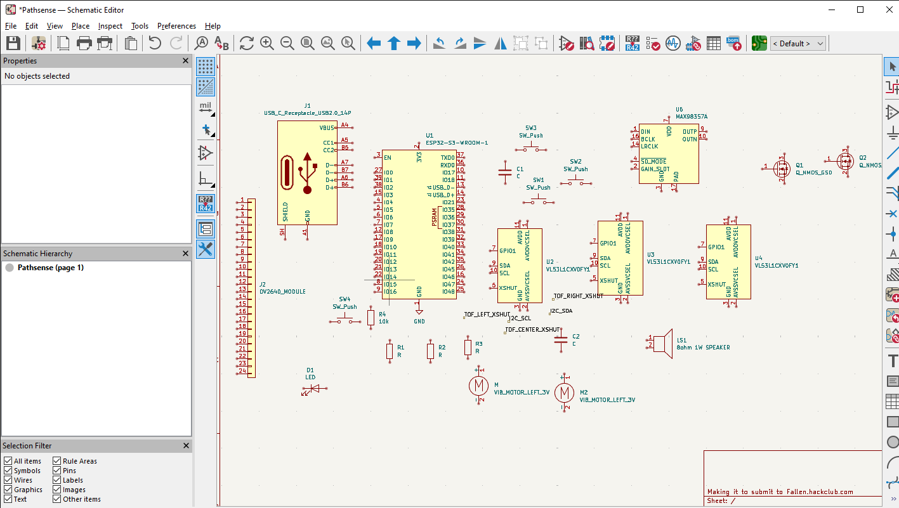
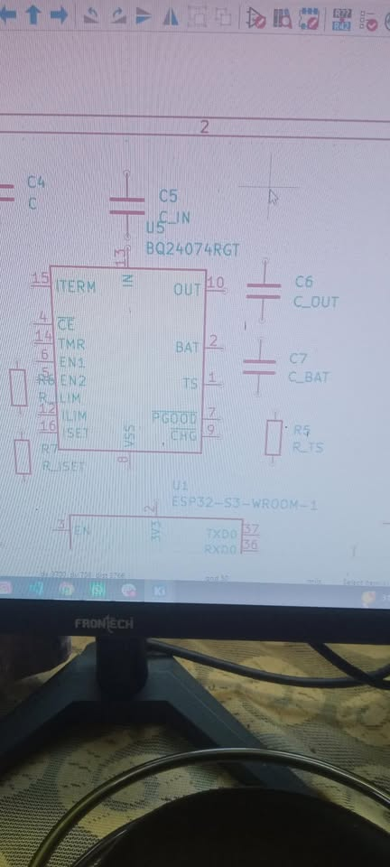

# Introduction
- - - - - - - - - - - -- -- - - - - - 

Pathsense is a wearable navigation-aid it uses 3 differnet sensor one in right, one in left, and one in stright direction. It uses its Custom PCB (which I am currently desinging). You can use it by wearing it in the place of your eye glasses. As of now I have thought to add 4-5 offline commands and responses. It will have a mic to take the input voice or command and a speaker to give out the output response. It will be able to communicate with you with the help of vibrataions, and voice(Speaker). Slight vibration if something is in a good distance but still there are chances to go and bump in it or getting in danger, Modreate vibration if something is in close and chances of getting bumped in it or getting in danger because of it is mid. And Strong vibration if chances are really high or the danger is very close. And with that we will have our Custom PCB with ESP32 connected to internet and AI to tell to go to the correct direction. It makes the work easy and safe.

# Why I made it / Project Goals.
- - - - - - - - - - - - - - - - - - - - - -

 (i)Detect nearby obstacles in three directions: left, centre and right.
 (ii)Communicate obstacle proximity through directional vibration patterns.
  (iii)Provide audio alerts for important events.
    (iv)Support offline voice commands, subject to available memory and firmware capabilities.
     (v)Explore camera based object recognition as an additional experimental feature.
      (vi)Include battery status indication and startup diagnostics.
       (vii)Design a custom PCB using KiCad.

       I made it to help people who are visually disabled get a better experience in the world. To help people who cant see properly and face many problems beacuse of it everyday.

  # How it works :
  The time of flight sensors meausre the distance between objects
  The ESP32-S3 processes the sensor readings.
  The system communicates obstacle direction and proximity through vibration patterns.
  Audio alerts provide additional warnings and system-status information.
  Annother speacial thing is it will have a Camara based reconigation feature. The camara will also help alot detecting objects viewing them properly get their size and get the best possible response from the Custom  Microcontroller. 

  Images of how much is done till now: 
  

  Image of Battery system: (Currently building)
  
    
